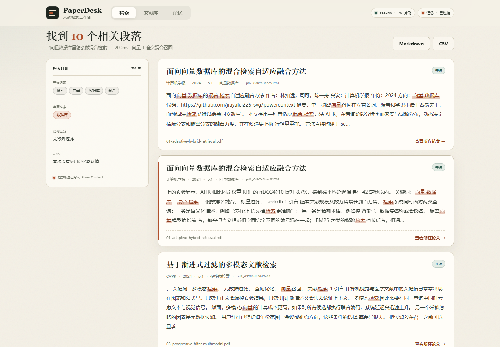

# PaperDesk 2.0

**从一句问题，翻到论文里的那一页。**

PaperDesk 是一个本地优先的中文文献检索工作台。导入 PDF 后，seekdb 会把论文切成语义片段，在同一个查询里完成向量召回、全文召回、标量过滤与 RRF 融合；PowerContext 保存你的检索偏好和检索轨迹，下一次提问时自动生效。

- 项目网站：[paperdesk-4qzym26fsnz.qoder.zone](https://paperdesk-4qzym26fsnz.qoder.zone)
- 代码目录：[`qoder/`](https://github.com/jiayalei225-svg/powercontext/tree/2026-competition-ecosystem/qoder)
- Qoder 开发记录：[docs/qoder-records.md](docs/qoder-records.md)
- 验收记录：[docs/verification.md](docs/verification.md)



## 它解决什么问题

读论文时真正麻烦的不是“找不到 PDF”，而是：

1. 记得一句结论，却不知道在哪篇论文、哪一页；
2. 语义相近的说法搜不到，精确术语又被向量模型稀释；
3. 每次检索都要重新填写年份、会议、方向这些老条件。

PaperDesk 把这三件事拆开处理：seekdb 负责“语义 + 字面 + 过滤”的联合召回，PowerContext 负责“用户偏好 + 检索进度”的长期记忆，界面只呈现检索计划和可点击的原文片段。

## 核心能力

| 能力 | 实现 |
| --- | --- |
| 混合检索 | seekdb `hybrid_search`：dense KNN + full-text，一次调用内完成 RRF 融合 |
| 标量过滤 | 年份区间、会议/期刊、研究方向、是否开源、单篇论文，下推到两路召回 |
| 段落级定位 | PyMuPDF 抽取 + 句读感知分块，命中直接给到页码与原文片段 |
| 长期记忆 | PowerContext `preference` 条目版本化保存，`progress` 条目记录每次检索 |
| 记忆优先级 | 用户显式填写的条件永远覆盖记忆默认值 |
| 结果多样化 | 同一篇论文最多返回 2 个片段，避免单篇刷屏 |
| 可追溯 | 每次检索展示查询词项、字面锚点、结构过滤、记忆来源 |
| 可导出 | Markdown / CSV 检索报告，CSV 带 UTF-8 BOM |
| 本地优先 | PDF、seekdb 索引、PowerContext 数据都在本机 |

## 快速开始

以下命令都在仓库根目录执行，先进入 `qoder/`：

```bash
cd qoder
```

### Windows

```powershell
powershell -ExecutionPolicy Bypass -File scripts\start.ps1
```

### macOS / Linux

```bash
bash scripts/start.sh
```

打开 <http://127.0.0.1:8080>。脚本会自动完成：

1. 创建 `.venv` 并安装依赖；
2. 从 `.env.example` 生成 `.env`；
3. 生成 PowerContext 配置并启动 `127.0.0.1:18000`，记忆库固定在 `runtime/powercontext/`；
4. 幂等导入 5 篇演示 PDF，并把原始 PDF 复制到 `data/uploads/`；
5. 启动 PaperDesk。

脚本会把当前 PowerContext scope 写入 `runtime/powercontext.scope`。如果 18000 端口已是另一个 scope 的服务，脚本会直接报错，而不是把记忆悄悄写到另一套数据库。首次运行需要联网下载 `bge-small-zh-v1.5` ONNX 模型；之后可离线运行。若 8080 被占用，可指定端口：

```powershell
$env:PAPERDESK_PORT = "18081"
powershell -ExecutionPolicy Bypass -File scripts\start.ps1 -SkipSeed
```

### 手动启动

先准备依赖与配置（Windows 用 `.venv\Scripts\Activate.ps1` 激活）：

```bash
cd qoder
python -m venv .venv
. .venv/bin/activate
pip install -r requirements.txt
cp .env.example .env
mkdir -p config runtime/powercontext
powercontext config init --template --output config/powercontext.env
```

终端 A 启动 PowerContext。`POWERCONTEXT_HOME` 必须和脚本使用同一个目录，否则重启后会读到一套空的记忆库：

```bash
export POWERCONTEXT_HOME="$PWD/runtime/powercontext"
powercontext server run --env-file config/powercontext.env --port 18000
```

Windows PowerShell：

```powershell
$env:POWERCONTEXT_HOME = "$PWD\runtime\powercontext"
powercontext server run --env-file config\powercontext.env --port 18000
```

终端 B 导入语料并启动 PaperDesk：

```bash
python scripts/seed.py
python backend/run.py
```

如果 PowerContext 跑在别的端口，在终端 B 设置 `POWERCONTEXT_URL=http://127.0.0.1:<port>` 再启动后端。

前端已构建产物在 `frontend/dist/`，后端会自动托管。修改前端后重新构建：

```bash
cd frontend
npm install
npm run build
```

## 配置

所有配置通过环境变量或 `.env` 提供，示例见 [`.env.example`](.env.example)。仓库只提交占位值：

```dotenv
EMBEDDING_MODE=local
EMBEDDING_API_BASE=
EMBEDDING_API_KEY=
EMBEDDING_MODEL=
POWERCONTEXT_URL=http://127.0.0.1:18000
```

- `EMBEDDING_MODE=local`：本地 ONNX `bge-small-zh-v1.5`，512 维，无需密钥。
- `EMBEDDING_MODE=api`：任意 OpenAI 兼容 embeddings 接口；密钥只放在本地 `.env`。
- 数据目录必须是纯 ASCII 路径；否则自动回退到 `%LOCALAPPDATA%\PaperDesk\data-v2`，避免 seekdb 无法打开。
- `.env` 与 `config/powercontext.env` 已在 `.gitignore` 中，不会进入仓库。

## 验证

```bash
# 单元测试：分块、元数据、过滤、记忆合并、导出、seekdb 往返
pytest

# 端到端验收：需要服务已启动
python scripts/accept.py --base http://127.0.0.1:8080
```

当前基线：**15 个单元测试全部通过**，**24 项端到端检查全部通过**。完整报告与样例见 [docs/verification.md](docs/verification.md)。

`accept.py` 不会在结尾清空偏好：它会先验证“清除”，再写入最终的四条偏好，并分别通过应用接口和 PowerContext 原始接口读回。最终 artifact 记录在 `docs/verification/report.json` 的 `final_artifact`；完全重启后的对照见 `docs/verification/restart-readback.json`。运行结束后打开记忆页，可以直接看到刚写入的偏好，不会出现“验收完成后记忆是空的”。

## 记忆读回与复用

PowerContext 的条目列表是 artifact 顺序，不是按时间倒序；只读第一页会在轨迹积累后漏掉最新偏好。PaperDesk 的实现是：

1. 读取时按 `kind=preference` 过滤，并沿 `next_cursor` 遍历全部页；
2. `GET /api/preferences?fresh=1` 绕过 12 秒进程缓存，强制从 PowerContext 重新读取；
3. `scripts/accept.py` 还会直接查询 PowerContext 的 `/v1/atomic-memory/list`，比对 artifact ID 与偏好内容，并在完全重启后再核对一次；
4. 下一次检索通过 `recall.plan` 逐字段合并偏好，并验证结果确实满足年份、会议、方向与开源条件。

复现：

```bash
curl "http://127.0.0.1:8080/api/preferences?fresh=1"
python scripts/accept.py --base http://127.0.0.1:8080
```

演示语料（全部为原创示例 PDF）：

| 文件 | 标题 | 会议/期刊 | 年份 | 代码 |
| --- | --- | --- | --- | --- |
| `01-adaptive-hybrid-retrieval.pdf` | 面向向量数据库的混合检索自适应融合方法 | 计算机学报 | 2024 | 有 |
| `02-memory-routed-rag.pdf` | 检索增强生成中的记忆路由与证据筛选 | ACL | 2025 | 有 |
| `03-hierarchical-chunking-rerank.pdf` | 面向长上下文检索的分层分块与重排序 | SIGIR | 2023 | 无 |
| `04-zh-keyphrase-low-resource.pdf` | 低资源场景下的中文科技文献关键词抽取 | 软件学报 | 2023 | 有 |
| `05-progressive-filter-multimodal.pdf` | 基于渐进式过滤的多模态文献检索 | CVPR | 2024 | 有 |

## 目录结构

```text
qoder/
├── backend/app/
│   ├── settings.py      # 环境配置、ASCII 数据目录回退
│   ├── embedding.py     # 本地 BGE / OpenAI 兼容嵌入
│   ├── pdf.py           # 抽取、元数据、句读感知分块
│   ├── index.py         # seekdb 读写、混合检索、标量过滤
│   ├── memory.py        # PowerContext 偏好与轨迹
│   ├── recall.py        # 查询词项、记忆合并、结果整形
│   ├── serialize.py     # Markdown / CSV 导出
│   └── server.py        # FastAPI
├── frontend/            # React 19 + TypeScript + Vite
├── samples/             # 5 篇原创演示 PDF
├── scripts/             # 启动、导入、CLI、验收
├── tests/               # pytest
├── docs/                # 架构、验收、开发记录、Qoder 记录
└── site/                # Qoder Sites 项目网站
```

## API 摘要

| 方法 | 路径 | 说明 |
| --- | --- | --- |
| GET | `/api/health` | 服务、索引、模型、记忆状态 |
| GET | `/api/papers` | 文献列表 |
| POST | `/api/papers` | 上传 PDF（multipart） |
| GET | `/api/papers/{id}` | 论文详情与片段 |
| DELETE | `/api/papers/{id}` | 删除论文与向量 |
| POST | `/api/search` | 混合检索 + 记忆计划 |
| POST | `/api/search/export` | Markdown 报告 |
| POST | `/api/search/export.csv` | CSV 报告 |
| GET | `/api/history` | 最近的检索轨迹 |
| GET/PUT | `/api/preferences` | 读取/保存记忆偏好 |
| GET | `/api/memory` | PowerContext 快照 |

交互式文档：<http://127.0.0.1:8080/api/docs>。更多示例见 [docs/api.md](docs/api.md)。

## 比赛要求对照

| 要求 | 落实 |
| --- | --- |
| 基于 `2026-competition-ecosystem` 分支 | 代码位于该分支的 `qoder/` 目录 |
| 真实使用 seekdb / PowerContext | seekdb 是唯一检索存储；PowerContext 是偏好与轨迹的唯一持久层，见 [docs/architecture.md](docs/architecture.md) |
| 主要开发在 Qoder 完成 | 本目录代码、测试、验收、站点均在本 Qoder 会话中完成，见 [docs/qoder-records.md](docs/qoder-records.md) |
| 网站通过 Qoder Sites 发布且公开 | <https://paperdesk-4qzym26fsnz.qoder.zone>，访问模式 public |
| 配置只用占位值 | [`.env.example`](.env.example) 仅含空值与本地地址；真实 `.env` 不入库 |
| 运行说明 / 验证样例 / 开发记录 | 本 README、[docs/verification.md](docs/verification.md)、[docs/qoder-records.md](docs/qoder-records.md) |

## 已知限制

- 项目网站是 Qoder Sites 上可公开访问的**项目介绍页**，不是在线版应用。Qoder Sites 只提供静态托管与 Edge Function，无法运行 Python、seekdb 本地引擎和 PowerContext 服务；完整应用请按“快速开始”在本机启动。
- 网站上的截图、artifact ID 与验收数字均来自本机真实运行，不把静态页面标成在线服务。
- 演示语料为 5 篇原创示例论文，用于复现检索与记忆链路，不代表真实文献综述。
- 本地 BGE 模型首次加载需要数秒；之后单次查询通常在数百毫秒。
- PowerContext 未启动时，检索与索引仍可用，但偏好与轨迹功能会自动降级。
- PDF 仅支持文本型；扫描件需要外部 OCR。

## 许可

本项目位于 `oceanbase/powercontext` 仓库的竞赛分支中，遵循上游仓库的许可协议。
