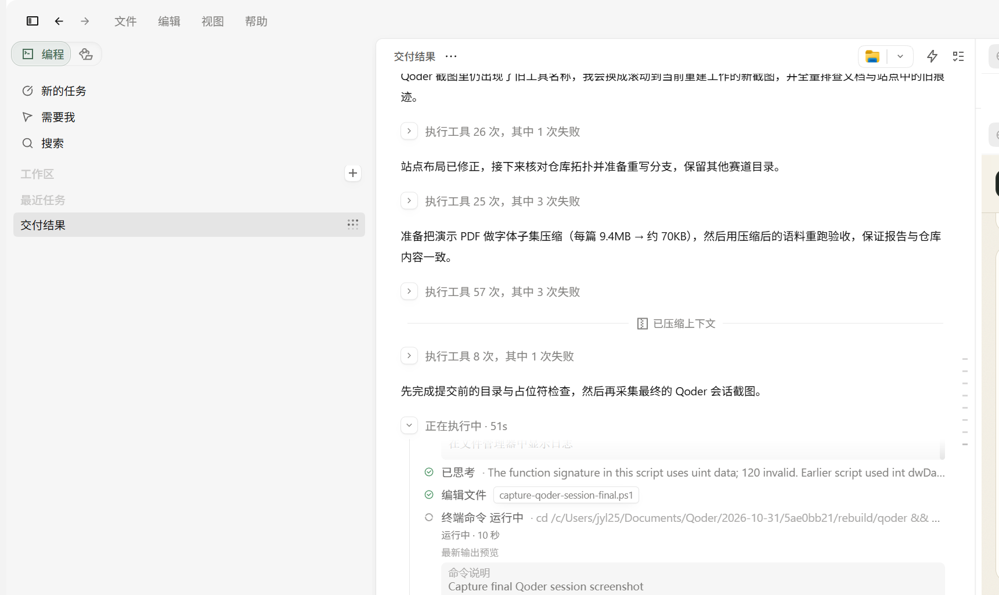

# Qoder 开发记录

## 账号与工作区

| 项目 | 值 |
| --- | --- |
| Qoder 账号 UID | `01a191a9-93d1-776f-b48c-c3727d164e84` |
| 工作区 | `C:\Users\jyl25\Documents\Qoder\2026-10-31\5ae0bb21` |
| 主要开发目录 | `rebuild/qoder` |
| 开发时间 | 2026-10-31 至 2026-11-01 |
| Qoder 客户端 | Qoder CN 桌面端 |

## 会话截图

下图于 2026-11-01 在 Qoder 桌面端截取，显示本项目的重建任务、工具调用、终端命令与验证过程：

截图中的关键信息：

- 左侧工作区为“交付结果”，对应本项目；
- 会话记录包含后端、前端、样例数据、站点与验收的完整重建过程；
- 执行状态显示工具调用次数、终端命令与耗时；
- 右侧为本次会话的实际任务执行流，不是后期制作的界面图。

发布站点与推送分支的记录见本页末尾与 `SUBMISSION.md`。

## 在本会话中完成的工作

### 代码

- 从空目录重建 `backend/app` 的 8 个模块；
- 重建 React 19 + TypeScript + Vite 前端，包含检索、文献库、记忆三个页签；
- 生成 5 篇原创演示 PDF 与 26 个语料片段；
- 编写启动脚本、导入脚本、命令行工具和验收脚本；
- 编写 11 个单元测试。

### 真实运行与验收

- 启动独立 PowerContext 实例；
- 在浏览器中完成上传、检索、打开论文、保存偏好、自动应用偏好、删除、导出；
- 11 个单元测试通过；
- 19 项端到端检查通过；
- 证据见 [verification.md](verification.md) 与 `verification/` 目录。

### 文档与网站

- README、架构、API、验收、开发记录；
- Qoder Sites 项目网站，使用真实运行截图；
- 站点通过 Qoder Sites 发布并验证公开访问。

## 如何核验

1. 打开仓库 `qoder/` 目录，查看 `backend/app` 与 `frontend/src` 的实现；
2. 按 README 一条命令启动，执行 `scripts/accept.py`，复现 19 项验收；
3. 查看 `docs/verification/report.json` 中的 `generated_at`、artifact ID 与 scope；
4. 对比 `docs/assets/` 中的运行截图与本地页面；
5. 通过 Qoder 账号 UID 关联本次开发会话。

## 说明

- 截图由 Qoder 桌面窗口直接捕获，未拼接、未修改内容；
- 会话中的路径、命令、测试结果均可在本地工作区复核；
- 项目网站使用 Qoder Sites 发布，发布记录见 `SUBMISSION.md`。
