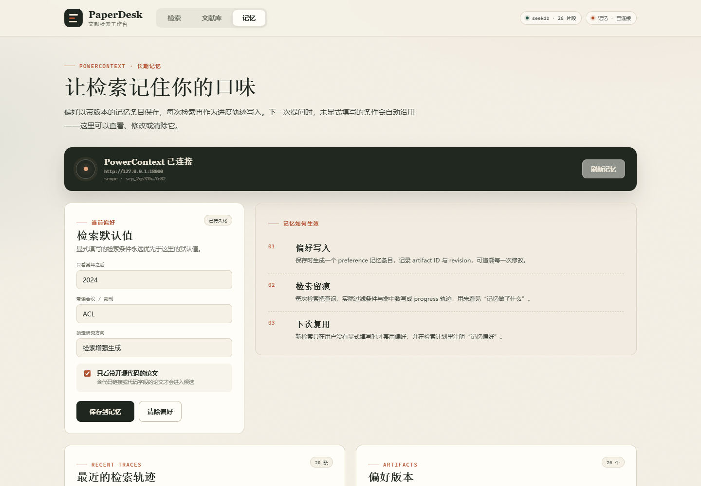
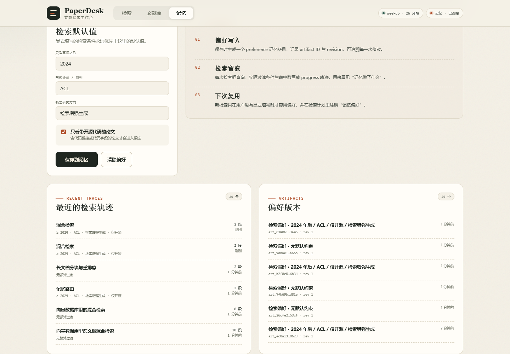
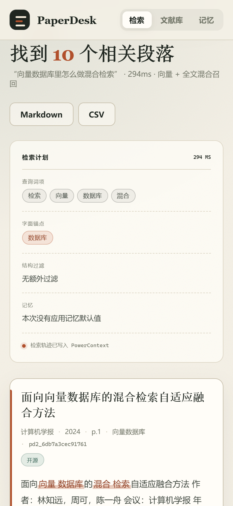

# 验收记录

验收时间：2026-11-01 11:32（本地时区）
重启读回：2026-11-01 11:34
验收环境：Windows 11，Python 3.13，PowerContext 1.4.1，seekdb 1.4.0，本地 BGE `bge-small-zh-v1.5` 512 维
服务地址：`http://127.0.0.1:18081`（本机 8080 被占用，用 `PAPERDESK_PORT` 覆盖；默认端口仍为 8080）

## 结论

| 项目 | 结果 |
| --- | --- |
| 单元测试 | **15 passed** |
| 端到端验收 | **24 / 24 PASS** |
| 论文入库 | 5 篇 / 26 个片段 |
| 混合检索 | 命中 6 个片段，`strategy=hybrid`，210 ms |
| 记忆偏好 | 保存、清缓存读回、绕过应用直读、自动应用、显式覆盖、清除、完全重启读回全部通过 |
| 最终 scope | `scp_2gs37bhwx70f9gqx00jr6z7c82` |
| 最终偏好 artifact | `art_6348613106ea4529a1c8745f10393a45`（revision 1） |
| 导出 | Markdown 2186 字节 / CSV 1648 字节（带 UTF-8 BOM） |
| PowerContext | 已连接；偏好与检索轨迹在完全重启后仍可读回 |

原始报告：

- [report.json](verification/report.json)
- [powercontext-readback.json](verification/powercontext-readback.json)：绕过 PaperDesk，直接分页读取 PowerContext 的最终偏好与 artifact
- [restart-readback.json](verification/restart-readback.json)：停止并重启 PowerContext 与 PaperDesk 前后的对照
- [search.json](verification/search.json)：一次真实检索的完整响应
- [preferences-search.json](verification/preferences-search.json)：应用记忆偏好后的完整响应
- [report.md](verification/report.md) / [report.csv](verification/report.csv)：导出的检索报告

## 单元测试

```text
$ python -m pytest
...............                                                          [100%]
15 passed
```

覆盖内容：

1. 句读感知分块与页码保留；
2. PDF 头部元数据解析；
3. 文件名回退；
4. seekdb 标量过滤条件组合；
5. 记忆偏好合并；
6. 显式条件覆盖记忆；
7. 每篇论文片段数上限；
8. 片段摘要围绕查询词；
9. Markdown / CSV 导出；
10. 演示 PDF 可读；
11. seekdb 写入、混合检索、过滤、删除往返；
12. PowerContext 全量翻页；
13. 最新偏好落在第二页时仍能读回；
14. 记忆快照同时保留偏好与旧轨迹；
15. 空偏好归一化。

## 端到端验收

执行：

```bash
python scripts/accept.py --base http://127.0.0.1:18081
```

| # | 检查 | 结果 | 证据 |
| --- | --- | --- | --- |
| 1 | 服务健康 | PASS | version=2.0.0，collection=`paper_chunks_v2_bge_zh` |
| 2 | PowerContext 连接 | PASS | scope=`scp_2gs37bhwx70f9gqx00jr6z7c82` |
| 3-7 | 导入 5 篇 PDF | PASS | 每篇 5-6 个片段；重复导入返回 `duplicate=true` |
| 8 | 文献库数量 | PASS | 5 篇 |
| 9 | 原始 PDF 可读回 | PASS | 5/5 篇 `/file` 返回 HTTP 200 且以 `%PDF` 开头 |
| 10 | 论文详情 | PASS | 返回 5 个片段 |
| 11 | 混合检索召回 | PASS | 命中 6，`strategy=hybrid`，210 ms |
| 12 | 搜索写入记忆 | PASS | `memory_connected=true` |
| 13 | 保存记忆偏好 | PASS | `artifact=art_b2f8c5…`，`revision=1` |
| 14 | 清缓存后从 PowerContext 读回 | PASS | 四字段与保存值一致 |
| 15 | 绕过应用直读 PowerContext | PASS | 分页直读同一 artifact 与四字段，`pages=1` |
| 16 | 记忆偏好自动应用 | PASS | 4 个字段生效，`notes=4`，`hits=2` |
| 17 | 显式条件覆盖记忆 | PASS | SIGIR / 2023 / 信息检索 / 无代码，`applied={}` |
| 18 | 清除记忆偏好 | PASS | 读取为 `{}` |
| 19 | 重新保存并读回最终偏好 | PASS | `artifact=art_634861…`，四字段一致 |
| 20 | 最终偏好与 artifact 可从 PowerContext 直读 | PASS | 同一 artifact、同一组四字段、`pages=1` |
| 21 | 导出 Markdown | PASS | 2186 字节，以 `# PaperDesk 检索报告` 开头 |
| 22 | 导出 CSV | PASS | 1648 字节，带 UTF-8 BOM |
| 23 | 检索轨迹 | PASS | 12 条 |
| 24 | 记忆快照保留偏好与轨迹 | PASS | scope + 4 个偏好字段 + 20 条轨迹 + 20 个版本 |

验收脚本在结尾不会清空偏好：它先验证清除，再把四条偏好写回，并分别通过应用接口和 PowerContext 原始接口读回。运行结束后打开记忆页，可以直接看到刚写入的偏好。

## 完全重启读回

2026-11-01 11:34 执行：

1. 停止 PaperDesk 后端与 PowerContext 进程；
2. 以同一个 `POWERCONTEXT_HOME=runtime/powercontext` 和数据目录重新启动；
3. 不调用写入接口，直接读取 `/api/preferences?fresh=1` 与 PowerContext `/v1/atomic-memory/list`。

对照结果：

| 项目 | 重启前 | 重启后 |
| --- | --- | --- |
| scope | `scp_2gs37bhwx70f9gqx00jr6z7c82` | 相同 |
| 偏好 | 2024 年后 / ACL / 仅开源 / 检索增强生成 | 相同 |
| artifact | `art_6348613106ea4529a1c8745f10393a45` | 相同 |
| 索引 | 5 篇 / 26 片段 | 相同 |

原始对照见 [restart-readback.json](verification/restart-readback.json)。

## 关键样例

### 1. 混合检索

查询：`向量数据库里怎么做混合检索`


- 词项：检索 / 向量 / 数据库 / 混合
- 字面锚点：数据库
- 策略：向量 + 全文混合召回
- 结果：10 个段落，首篇为《面向向量数据库的混合检索自适应融合方法》，计算机学报 2024
- 上图这次界面查询耗时 200 ms；验收脚本使用 `limit=6` 命中 6 段，界面默认 `limit=12` 展示前 10 段
- 服务空转后的首次查询通常需要加载 ONNX 模型

### 2. 原文定位

点击标题打开论文抽屉，可直接看到页码、片段序号、完整原文与“打开 PDF”按钮：


### 3. 记忆偏好

在记忆页保存“2024 年以后 / ACL / 检索增强生成 / 仅开源”，下一次不填写条件直接检索：



检索计划明确标注四条“记忆偏好”，结果全部满足条件，底部显示“检索轨迹已写入 PowerContext”：


偏好版本列表显示最新 artifact 与 revision，和保存响应、验收报告一致：



### 4. 文献库与移动端

| 文献库 | 移动端 |
| --- | --- |
|  |  |

## 复现步骤

```bash
cd qoder
pytest
python scripts/accept.py --base http://127.0.0.1:8080
```

如果使用默认端口，期望输出末尾为：

```text
共 24 项，通过 24，失败 0
```

## 说明

- 验收使用 `samples/` 下的 5 篇原创示例 PDF，不依赖外部网络与第三方文献；PDF 已做字体子集化，文本内容与分块结果不变。
- `scripts/accept.py` 会真实上传、检索、写记忆、导出并清理偏好，不是 mock。
- 报告中的 artifact 与 revision 来自 PowerContext 真实响应；每次运行会生成新的 artifact，以 `report.json` 的 `final_artifact` 为准。
- 截图来自本机实际运行界面，由 Qoder 会话内的无头浏览器捕获生成。
