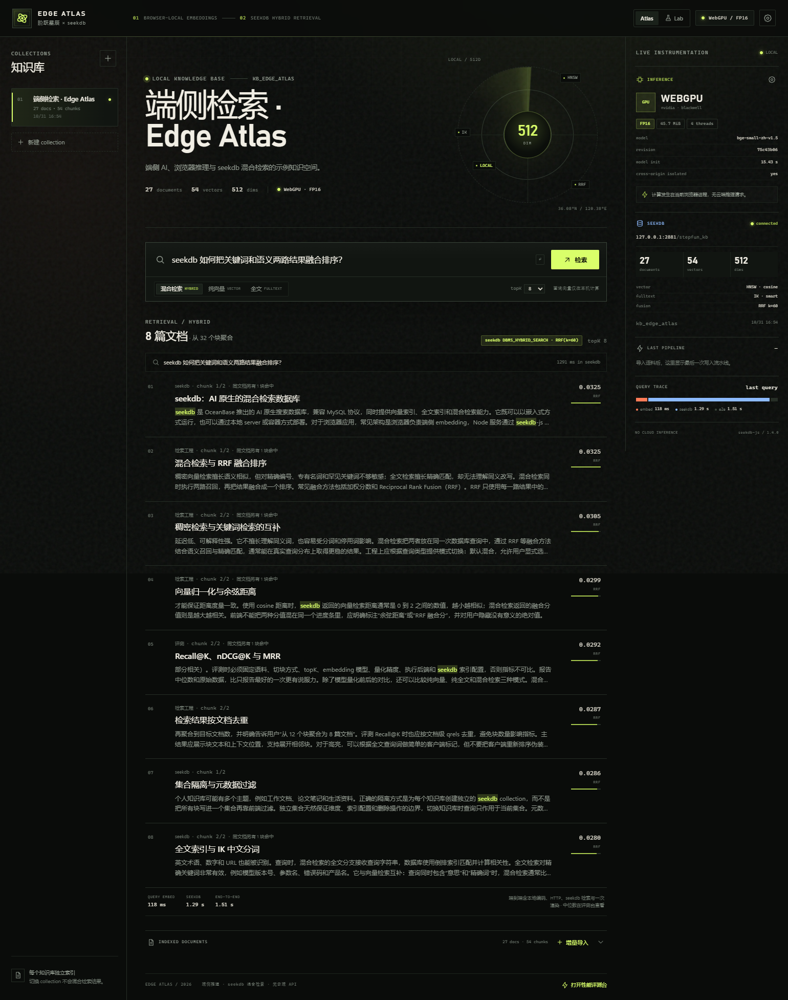

# Edge Atlas · 端侧知识库与 seekdb 混合检索

阶跃星辰赛题「端侧 AI 推理性能优化与 seekdb 混合检索」参赛作品。

提交分支：`2026-competition-ecosystem` · 目录：`stepfun/`
一页技术说明：[Markdown](docs/technical-report.md) · [PDF](docs/technical-report.pdf) · 测试记录：[test-report.md](docs/test-report.md)

**浏览器本地生成向量，seekdb 完成向量 + 全文混合检索。** 文档原文、向量与元数据全部留在自己的设备上；应用不调用任何云端推理 API，也没有服务端预计算向量。



## 1. 题目要求与实现

| 验收项 | 实现 |
| --- | --- |
| 完整流程 | 拖拽 / 粘贴 / 示例语料导入 → 本地 tokenizer 切块 → 浏览器 embedding → 写入 seekdb → 混合检索 → 排序展示原文 |
| 本地推理 | Transformers.js + ONNX Runtime Web，模型通过同源静态文件加载，Worker 内完成前向计算 |
| 模型量化 | BGE small 中文模型，INT8 动态量化 + FP16，提供体积、压缩比、检索质量对比；见 [技术说明](docs/technical-report.md) |
| 后端与降级 | 自动请求 WebGPU，失败时自动降级 WASM；界面显示实际后端、精度、适配器与降级原因 |
| seekdb 数据层 | seekdb-js server 模式；每个知识库独立 collection；HNSW cosine + IK 全文索引；`hybridSearch` 内部 RRF |
| 状态与刷新 | 增量导入 / 同 docId 替换；`refresh_index()` 后做自查询验证；集合注册表、文档数与最近导入时间持久化 |
| 可复现 | Docker Compose 启动 seekdb + npm 脚本下载固定 revision 模型 + 冒烟、降级、隔离、评测脚本 |

## 2. 快速启动

### 2.1 前置条件

- Node.js **20.19+**（本项目在 Node 24 上验证）
- Docker（推荐）或任意可达的 seekdb 1.4 server，默认 `127.0.0.1:2881`
- Chrome / Edge 最新版；WebGPU 可选，WASM 模式无需 GPU

### 2.2 启动步骤

```bash
cd stepfun

# 1. 安装依赖（.npmrc 已设置 legacy-peer-deps，原因见 2.3）
npm install

# 2. 下载固定 revision 的 ONNX 模型（优先使用 curl，支持 HTTPS_PROXY）
npm run setup:model

# 3. 启动 seekdb（若本机已有 seekdb server，可跳过）
docker compose up -d seekdb

# 4. 构建并启动
npm run build
npm start
# 打开 http://127.0.0.1:8787
```

开发模式（Vite + API 热更新）：

```bash
npm run dev
# UI  http://127.0.0.1:5173
# API http://127.0.0.1:8787
```

首次打开后，点击 **载入示例语料**，等待 27 篇文档完成切分、本地向量化、写入与索引刷新，然后可以直接使用页面预置问题或输入自己的问题。

### 2.3 关于 npm peer dependency

`seekdb@1.4.0` 的 optional peer `@seekdb/default-embed` 在 npm 上声明了 `workspace:*` 形式的 peer，npm 11 会因此报 `EUNSUPPORTEDPROTOCOL`。本项目**不使用**服务端 embedding function（向量在浏览器生成），所以 `.npmrc` 中设置 `legacy-peer-deps=true`，并显式把 collection 的 `embeddingFunction` 设为 `null`。这是有意设计，不是绕过 seekdb。

### 2.4 环境变量

复制 `.env.example` 为 `.env`，或直接设置环境变量：

```ini
SEEKDB_HOST=127.0.0.1
SEEKDB_PORT=2881
SEEKDB_USER=root
SEEKDB_PASSWORD=
SEEKDB_DATABASE=stepfun_kb
HOST=127.0.0.1
PORT=8787
SERVE_STATIC=1
```

`seekdb` 容器首次启动、或数据库尚不存在时，Node 服务会通过 `SeekdbAdminClient` 创建 `stepfun_kb`，然后创建默认 collection `kb_edge_atlas`。

## 3. 端侧推理

### 3.1 模型

| 项目 | 值 |
| --- | --- |
| 上游模型 | [`BAAI/bge-small-zh-v1.5`](https://huggingface.co/BAAI/bge-small-zh-v1.5) @ `7999e1d3359715c523056ef9478215996d62a620` |
| ONNX 转换 | [`Xenova/bge-small-zh-v1.5`](https://huggingface.co/Xenova/bge-small-zh-v1.5) @ `75c43b069aac4d136ba6bc1122f995fedcfd2781` |
| 结构 | BERT, 4 layers, hidden 512, 512 max tokens |
| 池化 / 归一化 | CLS pooling + L2 normalize |
| 查询侧 | 加入 BGE 官方中文检索 instruction：`为这个句子生成表示以用于检索相关文章：`；文档侧不加 |
| 维度 | 512 |
| License | MIT |

模型文件由 `npm run setup:model` 下载并做 SHA-256 校验，清单在 [`data/models.lock.json`](data/models.lock.json)。

### 3.2 精度与体积

| 精度 | ONNX | 实际加载 bundle（含 tokenizer/config） | 相对 FP32 |
| --- | ---: | ---: | ---: |
| FP32 | 90.46 MiB | 90.88 MiB | 1.000× |
| FP16 | 45.30 MiB | 45.72 MiB | 1.988× |
| INT8 | 22.90 MiB | 23.32 MiB | 3.897× |

INT8 由 ONNX Runtime dynamic quantization（weight-only, QUInt8, per-channel）生成；独立复现结果 24,020,718 bytes，与提交 artifact 相差 0.041%，合成输入 CLS 向量 cosine 0.9978。详见 [`docs/benchmarks/quantization.txt`](docs/benchmarks/quantization.txt) 和 [`scripts/quantize_model.py`](scripts/quantize_model.py)。

```bash
python -m pip install -r scripts/requirements-quant.txt
npm run quantize
```

### 3.3 后端选择与降级

`src/lib/embedding/embedding.worker.ts` 中：

1. 检查 `navigator.gpu`，调用 `requestAdapter({ powerPreference: "high-performance" })`；
2. 优先使用 WebGPU + FP16；
3. 没有 `navigator.gpu`、适配器为 `null`、或 WebGPU 模型加载失败时，自动用 WASM 重新创建 session；
4. WASM 默认 INT8；如果已有 collection 是用 FP16 建的，则保留 FP16 精度，避免跨精度 query/index 不一致；
5. UI 的 Header、Inspector 与设置面板都显示实际后端、精度、device 与 `fallbackReason`。

已验证两种环境：

- WebGPU 可用（Edge 156，NVIDIA Blackwell / AMD RDNA2）：Header 显示 `WebGPU / FP16`；
- WebGPU 不可用（`--disable-gpu`，adapter 返回 null）：Header 显示 `WASM / FP16`，Inspector 显示 `navigator.gpu 存在，但 requestAdapter() 返回空适配器`，检索流程继续可用。见 [WASM 降级截图](docs/screenshots/wasm-fallback.png)。

## 4. seekdb 数据层

### 4.1 Collection Schema

每个知识库创建独立 collection：

```js
new Schema({
  vectorIndex: new VectorIndexConfig({
    hnsw: {
      dimension: 512,
      distance: "cosine",
      type: "hnsw",
      m: 16,
      ef_construction: 200,
      ef_search: 100,
    },
    embeddingFunction: null, // 向量由浏览器生成，禁止服务端再次 embedding
  }),
  fulltextIndex: new FulltextIndexConfig("ik", { ik_mode: "smart" }),
});
```

每个 chunk 写入：

- `ids`: 由 `docId + chunkIndex + contentHash` 生成稳定块 ID；
- `documents`: 原始块文本；
- `embeddings`: 512 维归一化向量；
- `metadatas`: `docId`, `title`, `category`, `source`, `chunkIndex`, `chunkCount`, `charStart`, `importedAt`, `embeddingSpace`, `precision`, `contentHash`。

注册表 `stepfun_kb_registry` 保存知识库标题、描述、文档数、块数、最近导入时间，保证 Node 重启后集合状态与 UI 一致。

### 4.2 混合检索

`POST /api/kbs/:id/search` 根据模式调用：

```js
collection.hybridSearch({
  query: { whereDocument: { $contains: query } },
  knn: { queryEmbeddings: [vector], nResults: 32 },
  rank: { rrf: { rankWindowSize: 40, rankConstant: 60 } },
  nResults: 32,
  include: ["documents", "metadatas", "distances"],
});
```

两路召回、过滤和 RRF 融合都在 seekdb 内完成（`DBMS_HYBRID_SEARCH`）。客户端只把结果按 docId 聚合，不重新做向量检索或二次融合。纯向量、纯全文模式也全部通过 seekdb collection API 执行。

### 4.3 增量写入与索引刷新

- 同 docId 再次导入时先删除旧块，再写入新块；
- 每 16 个块一次 `collection.add`，避免单条 SQL 过大；
- 全部写入后调用 `refresh_index()`；
- 用刚写入块的自身向量做 topK 自查询，验证 ID 确实可被索引召回；失败会重试一次；
- 写入失败时清理本次新块，避免半成品；
- 更新注册表并刷新 UI 的文档数、块数、最近导入时间。

页面的“LAST PIPELINE”会分别显示切分、本地向量化、写入+refresh 与验证结果。

## 5. 实测结果

完整原始数据：[`docs/benchmarks/benchmark-final.json`](docs/benchmarks/benchmark-final.json) · [CSV](docs/benchmarks/benchmark-final.csv) · [冷/热启动](docs/benchmarks/cold-warm.json)。

测试条件：Windows 11，AMD Ryzen 9 8940HX（32 逻辑核），NVIDIA RTX 5060 Laptop（WebGPU NVIDIA Blackwell），Edge 156 headless，16GB 内存；seekdb 1.4.0 server；27 篇示例文档 / 54 个块；20 条查询、topK=5；WASM 4 threads。

| 配置 | Bundle 体积 | 文档向量化（54 块） | batch 16 吞吐 | 查询向量化 p50 | seekdb 检索 p50 | 端到端 p50 | Recall@5 | nDCG@5 | MRR@5 |
| --- | ---: | ---: | ---: | ---: | ---: | ---: | ---: | ---: | ---: |
| FP32 · WASM 基线 | 90.88 MiB | 24.32 s | 1.91 texts/s | 78.8 ms | 72.5 ms | 150.1 ms | 0.950 | 0.884 | 0.892 |
| INT8 · WASM | 23.32 MiB | 23.76 s | 2.26 texts/s | 78.5 ms | 103.5 ms | 185.1 ms | 0.950 | 0.878 | 0.879 |
| FP16 · WebGPU | 45.72 MiB | 5.97 s | **70.89 texts/s** | 78.6 ms | 112.2 ms | 190.9 ms | 0.950 | 0.884 | 0.892 |

质量对比使用同一套文档、query 集和 seekdb RRF 检索；完整逐条结果在 JSON 中。混合检索与单路对比：

| 配置 | Hybrid Recall@5 | Vector Recall@5 | Fulltext Recall@5 | Hybrid nDCG@5 | Vector nDCG@5 |
| --- | ---: | ---: | ---: | ---: | ---: |
| FP32 · WASM | 0.950 | 0.925 | 0.975 | 0.884 | 0.819 |
| INT8 · WASM | 0.950 | 0.925 | 0.975 | 0.878 | 0.803 |
| FP16 · WebGPU | 0.950 | 0.925 | 0.975 | 0.884 | 0.819 |

**结论**：

- FP16 + WebGPU 将文档批量吞吐从 ~2 texts/s 提升到 70.9 texts/s（batch 16），同时模型体积只有 FP32 的 1/1.99；batch 32 为 49.8 texts/s，说明 GPU 上 batch 16 是更好的工作点；
- INT8 将体积压到 23.3 MiB（3.90×），Recall 不变，nDCG 仅下降 0.69%；但本机 ORT Web 的 INT8 WASM 推理没有比 FP32 更快，因此我们不会把“更小”误报成“在 CPU 上更快”；
- 单条查询在 WebGPU/WASM 上都约 78 ms，端到端 150–191 ms；WebGPU 的优势主要在文档批处理，而不是单条 query 的 kernel launch 开销；
- 混合检索比纯向量有更高的 nDCG/MRR；在本语料上纯全文 recall 略高，但排序质量较低，RRF 融合取得了平衡。

冷/热启动：同一浏览器会话内，WebGPU FP16 首次页面加载 20.92 s，重载后 17.91 s。模型的 ONNX 文件以 `Cache-Control: no-store` 提供（Chromium 对大模型 body 偶发 `ERR_CACHE_WRITE_FAILURE` 的工程规避），因此热启动收益主要来自连接与浏览器内部缓存，而不是磁盘 HTTP 缓存；详见冷热数据 JSON 的说明。

> 说明：性能数字来自提交应用的真实页面运行；测试期间同一台笔记本还运行着其他开发进程，seekdb 写入/refresh 偶发长尾。表格使用基准脚本同一次完整运行的中位数（查询 p50 为 20 条 query 的 p50；batch 吞吐为 36 个固定块、预热后两轮取中位数）。绝对延迟会随设备、后台负载和 GPU 驱动变化，复现时请记录相同条件。

## 6. 目录结构

```
stepfun/
├─ server/
│  ├─ index.mjs              # Express API + 静态资源 + COOP/COEP
│  └─ seekdb-service.mjs     # 集合注册表、写入、刷新、混合检索
├─ src/
│  ├─ App.tsx                # Atlas 主界面
│  ├─ lab/LabView.tsx        # 性能实验室
│  ├─ lib/embedding/         # Worker + WebGPU/WASM 会话
│  ├─ lib/ingest.ts          # 切块 → embedding → 导入
│  ├─ lib/benchmark.ts       # 质量、延迟、batch 扫描
│  └─ components/            # 设置、导入、结果、Inspector 等
├─ data/
│  ├─ sample-corpus.json     # 27 篇中文技术卡片
│  ├─ eval/queries.json      # 20 条查询 + 文档级 qrels
│  └─ models.lock.json       # revision / 文件 SHA-256
├─ scripts/
│  ├─ download-model.mjs     # 模型下载 + 校验
│  ├─ prepare-assets.mjs     # 复制 ORT wasm / 生成 manifest
│  └─ quantize_model.py      # ONNX Runtime INT8 复现脚本
├─ benchmark/
│  ├─ run-benchmark.mjs      # 完整评测（Lab）
│  ├─ smoke-test.mjs         # 端到端导入 + 检索
│  ├─ fallback-test.mjs      # 无 WebGPU 降级
│  ├─ collection-test.mjs    # 新建 / 切换 / 隔离 / 删除
│  └─ cold-warm.mjs          # 冷/热启动
├─ docs/
│  ├─ technical-report.md    # 一页技术说明
│  ├─ test-report.md         # 详细测试记录
│  ├─ benchmarks/            # 原始 JSON / CSV / 量化日志
│  └─ screenshots/
├─ docker-compose.yml
└─ README.md
```

## 7. 自动化验证

应用与 seekdb 启动后：

```bash
# 1. 端到端：导入 27 篇示例语料 + 混合检索 + 截图
npm run smoke

# 2. 无 WebGPU 环境自动降级 WASM，并完成检索
npm run test:fallback

# 3. 新建 collection、粘贴导入、切换隔离、删除
npm run test:collection

# 4. 完整 Lab 评测（模型体积 / 质量 / 延迟 / batch）
npm run benchmark
```

脚本使用本机 Edge 的 `playwright-core`，不会下载另一套浏览器。需要安装 Edge：

- Windows 默认路径：`C:\Program Files (x86)\Microsoft\Edge\Application\msedge.exe`
- 其他平台请把脚本里的 `executablePath` 改为 Chrome/Edge 路径。

## 8. 数据与安全边界

- 浏览器只把 **向量、块文本、元数据** 通过同源 HTTP 发给本地 Node 服务；Node 服务只连接本地 seekdb，不调用第三方推理 API。
- 正常路径的服务端日志不记录块文本；错误信息可能包含 SQL 摘要，但不会把用户文档发送到外部。
- 应用是单用户本地演示，未实现登录、多租户和公网鉴权；不要直接暴露到公网。
- 文档和向量写入 seekdb；没有 IndexedDB / 浏览器内存检索兜底，也没有“服务端预计算向量回放”。

## 9. 已知限制

- 模型体积较大（FP32 90.9 MiB、FP16 45.7 MiB、INT8 23.3 MiB 的 bundle），首次 WebGPU 初始化约 15–21 s，属于本机实测的冷启动成本；模型下载不计入推理时间。
- WebGPU 的 GPU 选择由浏览器/操作系统决定。本机默认会选集成显卡；自动化脚本用 `--force_high_performance_gpu` 复现 RTX 5060 的数据。
- seekdb 采用 server 模式，需要先启动数据库；`docker compose up -d seekdb` 已给出可复现的本地 server 配置。浏览器端推理与 seekdb server 模式是解耦的。
- 本仓库不提交模型二进制（`.gitignore` 排除 `public/models/`），通过固定 revision + SHA-256 的下载脚本复现。

## 10. 参考

- [seekdb 混合检索文档](https://docs.seekdb.ai/seekdb/hybrid-search/)
- [seekdb-js SDK](https://github.com/oceanbase/seekdb-js)
- [Transformers.js](https://github.com/huggingface/transformers.js)
- [BAAI/bge-small-zh-v1.5](https://huggingface.co/BAAI/bge-small-zh-v1.5)
- [Xenova/bge-small-zh-v1.5](https://huggingface.co/Xenova/bge-small-zh-v1.5)
